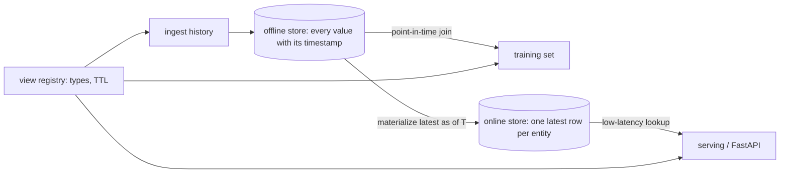

# featurestore-lite

A small feature store that solves the two problems feature stores exist for: building training sets
**without leaking the future**, and serving the **same** features online with low latency. It is
deliberately minimal (SQLite and the standard library, plus FastAPI for serving) so the ideas stay
visible instead of being buried under infrastructure.

## The problem it addresses

Suppose you train a model to predict churn from a customer's recent order count, and the label
is created on 15 February. If you join the *latest* order count to that row, you may be using a
value that was only computed in March. The model looks great offline and fails in production,
because that information did not exist at prediction time. This is label leakage.

The fix is a **point-in-time join**: for each training row, take the most recent feature value
known *at or before* that row's timestamp, and nothing later.

## Architecture



## Concepts

- **Feature view**: a named group of typed features about one entity type, with an optional TTL.
- **Offline store**: the full timestamped history. Used to build training sets.
- **Online store**: only the latest value per entity. Used to answer requests quickly.
- **TTL**: the maximum age of a value when it is used. Older values are returned as `None`, so a
  stale signal cannot quietly feed a model.
- **Materialisation**: copying the latest values from offline to online. It is idempotent and
  never moves an entity backwards in time.

## Setup

```bash
uv sync
uv run pytest
uv run python -m featurestore.cli      # tiny demo of the leakage-free join
```

## Usage

```python
from featurestore import FeatureStore, FeatureType, FeatureView

store = FeatureStore("features.db")  # or ":memory:"
store.register(
    FeatureView(
        "customer_stats",
        "customer",
        {"orders_30d": FeatureType.INT, "avg_basket": FeatureType.FLOAT},
        ttl_seconds=45 * 86400,
    )
)
store.ingest(
    "customer_stats",
    [
        {"entity_id": "c1", "event_ts": "2026-02-01", "orders_30d": 4, "avg_basket": 35.0},
        {"entity_id": "c1", "event_ts": "2026-03-01", "orders_30d": 9, "avg_basket": 60.0},
    ],
)

refs = ["customer_stats:orders_30d", "customer_stats:avg_basket"]

# Training: what was known on 15 February? (4 orders, not 9)
train = store.get_historical_features([{"entity_id": "c1", "event_ts": "2026-02-15"}], refs)

# Serving: copy the latest values online, then look them up
store.materialize("customer_stats")
live = store.get_online_features(["c1"], refs)
```

HTTP service:

```bash
uv run uvicorn featurestore.api:app --reload
```

| method and path | purpose |
| --- | --- |
| `PUT /views` | register a view |
| `POST /views/{name}/ingest` | append history rows |
| `POST /views/{name}/materialize` | copy latest values to the online store |
| `POST /features/historical` | point-in-time training join |
| `POST /features/online` | online lookup |

Set `FEATURESTORE_DB` to a file path to persist data between restarts.

## Design notes

- **A test enforces the leakage guarantee.** It sweeps many timestamps and checks that the joined
  value is always exactly the latest one at or before that time. Another test checks that the
  online value equals the training-join value at the same instant, which is the offline/online
  consistency property.
- **Features are validated on ingest.** Wrong types and missing or unexpected columns are rejected
  early, because discovering a type mix-up during training is far more expensive.
- **Each row carries all of a view's features.** That keeps "latest row" well defined. Features
  that update at different rates belong in different views.
- **Limitations.** The point-in-time join issues one indexed query per training row, which is fine
  for thousands of rows but not for billions. A production system would do this as a bulk as-of
  join in a warehouse or dataframe engine. There is no late-arriving-data handling, access
  control, or streaming ingestion, and SQLite means a single writer.

## Tests

```bash
uv run ruff format --check . && uv run ruff check . && uv run mypy src && uv run pytest
```

## Docker

```bash
docker build -t featurestore-lite . && docker run -p 8000:8000 featurestore-lite
```
